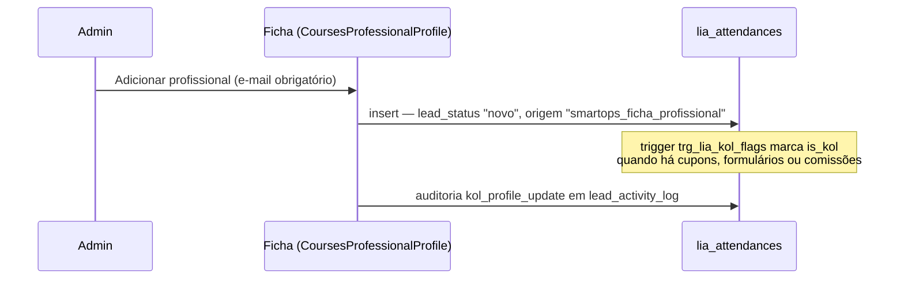
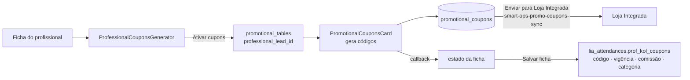
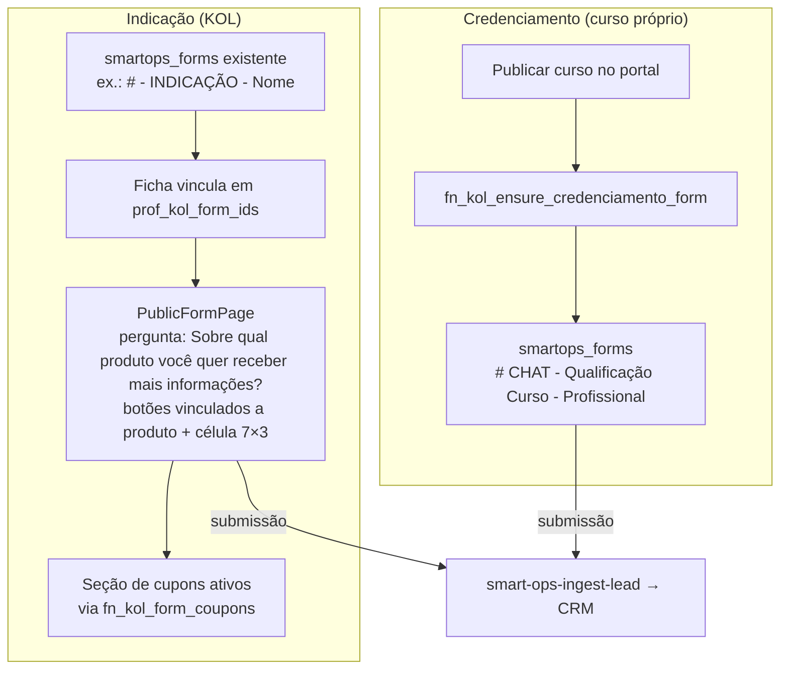

# 16 — Fluxo de Profissionais (KOL): cadastro, cupons, formulários e portal

Desenho do fluxo **como está hoje** no código.

## 16.1 Visão geral

```mermaid
flowchart TB
  subgraph Admin["Admin — Cursos / Profissionais"]
    CP[CoursesPage<br/>Adicionar profissional]
    FICHA[CoursesProfessionalProfile<br/>ficha do profissional]
    DEF[KolCommissionDefaultsDialog<br/>padrão de comissão]
    SHARE[ShareCoursePortalDialog<br/>Compartilhar link]
  end

  subgraph DB[(Banco)]
    LIA[lia_attendances<br/>prof_kol_form_ids · prof_kol_coupons<br/>prof_kol_commissions · is_kol]
    PT[promotional_tables<br/>professional_lead_id]
    PC[promotional_coupons]
    SF[smartops_forms]
    TOK[professional_portal_tokens]
    KC[kol_contracts]
  end

  subgraph Ext["Externos"]
    LI[Loja Integrada<br/>cupons ativos na loja]
  end

  subgraph Pub["Público"]
    FORM[PublicFormPage<br/>formulário de indicação<br/>mostra cupons via fn_kol_form_coupons]
    INGEST[smart-ops-ingest-lead<br/>lead entra no CRM]
    PORTAL[ProfessionalCoursePortal<br/>/portal-cursos/:token]
  end

  CP --> FICHA -->|insert/update| LIA
  DEF -->|copiado na criação do KOL| LIA
  FICHA -->|Ativar cupons| PT --> PC -->|smart-ops-promo-coupons-sync| LI
  PC -->|Salvar ficha grava vínculo| LIA
  FICHA -->|vincula formulários existentes| SF
  SHARE -->|token ativo reutilizado| TOK
  TOK --> PORTAL
  SF --> FORM --> INGEST --> LIA
  PORTAL -->|edge professional-course-portal| LIA
  PORTAL --> KC
```

## 16.2 Cadastro do profissional



- Não existe tabela separada de profissional: é um registro de `lia_attendances`.
- O padrão de comissão (KolCommissionDefaultsDialog → `kol_commission_templates`) é copiado para a ficha na criação; mudar o padrão depois não altera KOLs existentes.

## 16.3 Cupons de desconto



Regras:
- A tabela promocional só é criada quando alguém clica em **Ativar cupons** (nunca ao visualizar).
- Cupom gerado só fica vinculado ao KOL depois de **Salvar** a ficha.
- `coupon_discount_percent` (benefício do cliente) é diferente de `percent` (comissão do KOL) — não misturar.
- Exclusão de cupom: lixeira na aba comercial da ficha, vale após salvar.

## 16.4 Formulários



- Indicação: o formulário já existe e é **vinculado** na ficha; não há criação automática.
- Credenciamento: criado automaticamente ao publicar curso próprio (RPC idempotente), com campos nome, e-mail, WhatsApp, área, especialidade, scanner e impressora.
- `fn_kol_form_coupons` resolve o profissional **pelo nome do formulário** (precisa conter "indica"), não por `prof_kol_form_ids`.

## 16.5 Página do profissional (portal)

```mermaid
flowchart LR
  SHARE[Compartilhar link<br/>ShareCoursePortalDialog] --> TOK[(professional_portal_tokens<br/>token único reutilizado)]
  TOK --> URL[/portal-cursos/:token]
  URL --> EF[edge professional-course-portal<br/>valida token · revoke · expiração]
  EF --> S1[Meus dados<br/>+ CNPJ lookup BrasilAPI]
  EF --> S2[Contrato de parceria<br/>assinatura → PDF → Drive]
  EF --> S3[Performance<br/>mês/ano · formulários · e-commerce · negociação]
  EF --> S4[Tabela de preços<br/>promotional_tables kol_visible]
  EF --> S5[Cursos Smart Dent / Meus cursos]
  EF --> S6[Engajamento social]
  EF --> S7[Comissão vigente]
```

- O link é sempre o mesmo: token ativo é reutilizado e a validade estendida.
- Tudo passa pela edge function `professional-course-portal`; o portal nunca lê o banco direto.

## 16.6 Pontos de atenção conhecidos

1. `fn_kol_form_coupons` depende do **nome** do formulário conter "indica" + nome do profissional — frágil.
2. Cupom gerado sem "Salvar" a ficha não aparece no formulário público nem nas métricas.
3. Cursos Smart Dent sem `instructor_lead_id` são associados por igualdade de nome do professor.
4. Tabela de preços só aparece no portal se `kol_visible = true` (PDF opcional; o portal monta o PDF na tela se não houver arquivo).
